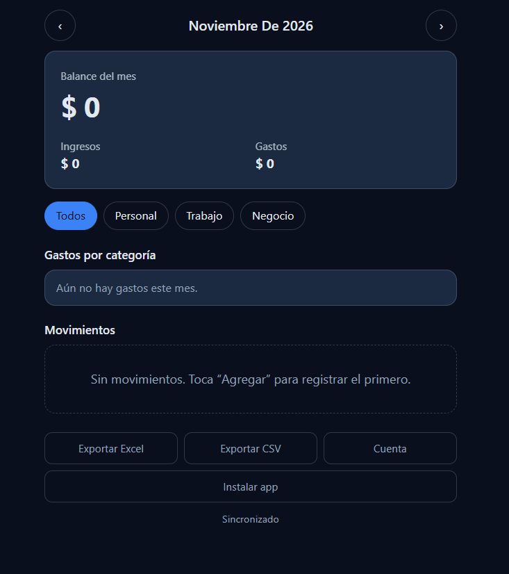

# Finanzas

> Registra lo que entra y lo que sale en COP sin depender de hojas de cálculo pesadas ni de tener internet todo el día.

**Finanzas** es una PWA ligera hecha en JavaScript, HTML y CSS pensada para el uso diario desde el celular o el computador. Empieza funcionando al instante en tu dispositivo y, si quieres, sincroniza tus movimientos en la nube con Supabase o exporta reportes listos para revisar.

## ¿Por qué probarla?

- **Sin fricción y sin conexión:** guarda todo localmente con `localStorage` y un `Service Worker`, así que puedes anotar un gasto en la calle o en el transporte aunque no haya señal.
- **Clara de un vistazo:** muestra el balance del mes, ingresos y gastos, barras por categoría y movimientos agrupados por día.
- **Separa tus contextos:** filtra por `Personal`, `Trabajo` o `Negocio` para no mezclar cuentas de la casa con las de un emprendimiento o actividad laboral.
- **Exporta a tu manera:** descarga un **CSV** al instante sin internet (con formato listo para Excel en español) o genera un **Excel (`.xlsx`)** desde el servidor con hojas de *Resumen* y *Movimientos* filtradas por período o ámbito.
- **Pensada para depurar en el móvil:** incluye una consola oculta (`?debug=1` o 5 toques en el título del mes) para revisar logs, tiempos y errores directamente en el teléfono sin necesidad de conectar el cable ni abrir DevTools.

## Vista previa

### Index principal

  

### Gastos eh ingresos

  

## Cómo funciona por dentro

- **Frontend sin frameworks:** `index.html`, `styles.css`, `app.js`, `api.js` y `exportar.js` trabajan juntos para mantener la interfaz rápida y fácil de leer o modificar.
- **Nube opcional con Supabase:** si configuras `config.js` y tu tabla `gastos` con políticas RLS, puedes iniciar sesión y sincronizar entre dispositivos.
- **Reporte Excel en el servidor:** la Edge Function en `supabase/functions/exportar-excel/index.ts` valida la sesión, aplica filtros de fecha y ámbito, y construye el libro con `ExcelJS`.

## Ideas en el radar

- Edición rápida de movimientos existentes.
- Comparativas entre meses para ver tendencias de gasto.
- Ajustes visuales y mejoras en la experiencia de exportación.

---

Si estás armando una app de finanzas personales, experimentando con PWAs + Supabase o buscas ideas de estructura simple sin frameworks pesados, siéntete libre de explorar el código.